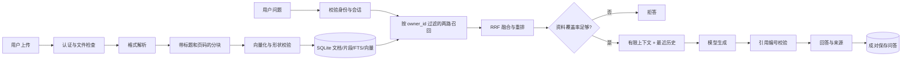
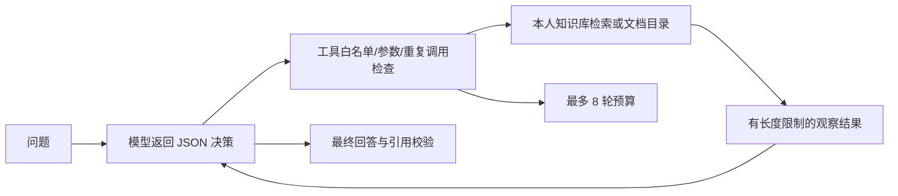
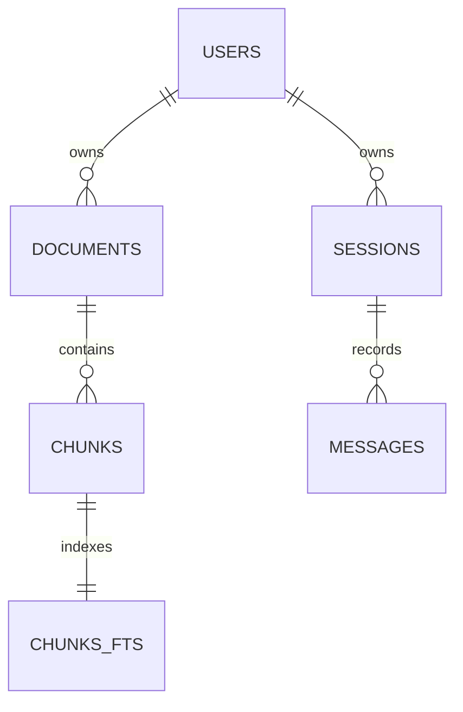

# 项目背景、功能与代码导读

本文介绍 kb-agent 的业务定位、系统流程、模块划分与关键实现决策，帮助新读者从入口代码一路追到数据库和检索层。

## 1. 这个项目解决什么问题

企业通常把知识分散在制度文件、操作手册、项目说明和 FAQ 中。员工想知道“住宿费能报多少”，传统做法是找到文件、搜索关键词、定位条款、核对版本。通用语言模型无法直接知道企业内部资料，直接让模型作答容易得到看似合理但没有依据的结果。

kb-agent 把这条路径变成：**先从本人上传的资料中找片段，再让模型根据片段回答，最后展示来源。** 这是 RAG（检索增强生成）的基本思路。资料变化时重新导入即可，不需要重新训练模型。

代码里大量使用 Spring、Controller、DTO、JdbcTemplate 的类比，又提供离线假模型、CLI 和评测器。由此判断，它很适合 Python/后端开发与大模型应用工程学习，也适合作为小规模知识库原型。它不是完整的企业 SaaS：没有组织管理、审批流、版本治理、后台任务队列和分布式向量服务。

举例：

1. 员工上传《差旅报销制度》。
2. 服务提取“住宿标准”章节，切成片段并建立索引。
3. 用户问“一线城市住宿费每晚最多多少”。
4. 系统检索到“每晚最多 600 元”，将其标记为资料 `[1]`。
5. 模型回答“每晚最多 600 元。[1]”，网页展示文件名、章节和原文。
6. 如果问的是资料中没有的股票代码，则优先拒答。

这里的资料充分性评分和引用检查只能降低部分错误，不能证明每句答案都被原文支持。

## 2. 系统的两条主流程

第二条是 Agent 流程：

RAG 的步骤固定，适合大部分简单问答。Agent 让模型决定是否继续检索，适合需要多步查找的任务，但更贵、更慢，而且可能选错工具或参数。当前没有证明 Agent 比固定 RAG 更准确；应使用相同问题集比较。

## 3. 模块地图与建议阅读顺序

路径均相对项目根。

| 顺序 | 文件 / 目录 | 主要职责 | 阅读时要回答的问题 |
| --- | --- | --- | --- |
| 1 | `cli.py`、`api/routes.py` | 两个用户入口 | 一次请求最终调用哪个服务？ |
| 2 | `api/deps.py` | 组装 Database、Embedder、LLM、Retriever、RAG | 为什么对象创建集中在这里？ |
| 3 | `schemas.py` | 请求响应模型 | 哪些数据由客户端提供，哪些由服务器确定？ |
| 4 | `core/config.py` | 环境变量、路径和配置校验 | 错误配置为什么应在启动时暴露？ |
| 5 | `core/db.py` | SQLite 表、事务、索引、会话 | 写操作怎样保证全有或全无？ |
| 6 | `ingest/loaders.py` | 提取正文和来源 | 格式解析会丢失哪些信息？ |
| 7 | `ingest/splitter.py` | 按字符窗口和断句位置分块 | overlap 为什么影响召回和冗余？ |
| 8 | `ingest/indexer.py` | 上传状态机和索引事务 | 失败重试如何保持幂等？ |
| 9 | `core/text.py` | 中文字符、bigram 和英文 token | 自定义 token 怎样配合 FTS？ |
| 10 | `retrieval/lexical.py`、`dense.py` | 字面与向量召回 | 两路各擅长什么？过滤在哪里发生？ |
| 11 | `retrieval/fusion.py`、`service.py` | 合并和重排 | 为什么不能直接相加原始分数？ |
| 12 | `retrieval/idf.py`、`gen/rag.py` | 资料充分性与生成编排 | 分数能否当成正确率？ |
| 13 | `gen/prompt.py`、`gen/llm.py` | 消息构造和供应商边界 | 如何用假模型隔离网络依赖？ |
| 14 | `gen/agent.py` | 有界工具循环 | 模型生成的参数应被当作可信输入吗？ |
| 15 | `api/static/` | 界面、SSE、会话 | HTTP 200 之后为何仍然可能失败？ |
| 16 | `eval.py`、`tests/`、`scripts/` | 质量、正确性与性能证据 | 指标口径与业务目标一致吗？ |

依赖方向为 `api → gen → retrieval → ingest → core`，上层可以直接依赖更低层，但下层不应导入上层。`schemas.py` 是共享接口契约。`scripts/check_arch.py` 用 AST 检查显式导入方向，不是完整的运行时架构证明。

如果熟悉 Java：`Settings ≈ ConfigurationProperties`，Pydantic 模型近似 DTO + 校验，`Depends` 类似显式依赖注入，`Protocol` 类似接口，数据库上下文管理器类似显式事务边界。两种语言的运行时和并发模型不同，不要把这些类比当作完全等价。

## 4. 数据模型

- `users`：密码哈希、角色、创建时间；JWT 校验成功后仍查用户是否存在。
- `documents`：所有者、文件名、内容摘要、状态、片段数、错误。`(owner_id, content_hash)` 唯一索引用于同用户判重。
- `chunks`：正文、标题、页码、顺序和向量 BLOB。向量采用小端 float32 存储。
- `chunks_fts`：独立 FTS5 全文索引，`rowid` 与片段 ID 对应。
- `sessions/messages`：按用户归属保存问答；一次成功问答的两条消息在同一事务提交。
- `metadata`：语料修订号与向量模型签名。修订号用于缓存失效，模型签名用于防止错误混用向量。

FTS 表的对应关系不是外键约束，删除同步由触发器完成。上传时正文与 FTS 在同一事务插入。修改原始片段正文不应绕过索引构建流程；修订号更新不等于自动重新生成 FTS 和向量。

## 5. 文档接入的关键细节

### 5.1 解析不是“读取所有知识”

Markdown/TXT 按标题组织正文；DOCX 使用安全 XML 解析器读取段落、标题和表格行；PDF 提取文本并保留页码。扫描 PDF、图中文字、复杂版式、多列和合并表格都可能需要专门方案。当前 DOCX 对合并单元格不保留完整结构。

### 5.2 分块参数实际含义

默认 `chunk_size=420` 表示字符数，不是模型 token 数。算法在窗口末端寻找句末标点，保留 `overlap=60` 的重叠。每个片段携带标题和页码，标题还会参与全文索引及向量化。

过小的片段可能将条件与结论拆开；过大的片段会增加无关内容、上下文成本和回答干扰。应先检查 `GET /api/documents/{id}/chunks`，再用评测比较参数，而不是凭经验指定“最佳大小”。

### 5.3 幂等和事务

新版把“查重 + 认领文档记录”放在写事务内。只有首次创建或成功认领失败记录的调用方会构建索引，其他并发调用返回当前记录。解析和远端向量化发生在事务外，避免长时间占用写锁；最后才提交一整批片段、FTS 和 `ready` 状态。

失败会记录为 `failed`，再次上传相同内容可重试。进程崩溃的自动恢复尚未实现；这也是引入持久任务队列和租约的实际动机。

## 6. 检索算法如何配合

### 6.1 字面检索

`core/text.py` 将文本预分词，再交给 SQLite FTS5。FTS5 的 `bm25()` 分数越小越相关，代码将其取反统一为“越大越好”。这一路适合型号、专有名称、精确术语。实现细节可对照 [SQLite FTS5 官方文档](https://www.sqlite.org/fts5.html)。

### 6.2 向量检索

向量在入库时 L2 归一化，因此点积可以表示余弦相似度。新版每次读取 512 个向量，保留局部 Top-K，再合并为全局 Top-K，最后读取命中正文。内存受批大小控制，但计算仍然扫描全部候选向量，复杂度约为 `O(N × D)`。

默认 `HashingEmbedder` 是确定性的 token 哈希投影，没有训练出的语义空间，不能期待它理解“报账”和“费用报销”是近义表达。真实语义模型的效果、语言覆盖和向量维度需单独验证。

### 6.3 RRF 和规则重排

RRF 对每条召回列表按排名计分：`score(d) = Σ 1 / (k + rank(d))`。默认 `k=60`。这种方法避免直接相加 BM25 和余弦两种不同尺度的原始分数。

随后重排使用 `0.65 × 归一化 RRF + 0.35 × 查询 token 覆盖率`。这是可解释的规则，不是训练好的 Cross-Encoder。规则偏向词面匹配，在同义改写和复杂问题上可能失效。

### 6.4 用户过滤的位置

全文和向量查询在 SQL 中就带上 `owner_id`，避免先从所有人文档取 Top-K、再过滤导致漏召回与信息泄漏。客户端 `doc_ids` 只会进一步缩小范围，不能扩大权限；`None` 表示用户全部文档，`[]` 表示空范围。

IDF 也按用户隔离。FTS5 自身的语料统计仍由共享表维护；如果需要强统计隔离或完全独立租户生命周期，需要独立库/索引或更强的数据库隔离方案。

## 7. 回答生成的质量边界

1. `assess_answerability` 计算问题信息字符在 Top-3 片段中的 IDF 加权覆盖率；它是门槛信号，不是模型正确率。
2. `build_context` 最多装入 12000 个资料字符；这并不等于精确 token 预算。
3. Prompt 把资料放到本轮用户消息中，系统规则明确资料只是数据。它降低部分指令混淆，但不是完整的提示注入防护。
4. 最近 4 条历史供生成参考，当前问题不会重复写入历史。检索仍基于当前问题，没有自动指代消解，因此“那二线城市呢”可能检索不充分。
5. 最终检查引用是否存在、编号是否越界。无引用或非法引用会拒答；有效编号不能证明引用片段支持全部结论。
6. SSE 生成期间的内容可能尚未通过检查，客户端必须以 `done` 中的最终回答覆盖显示。不能把 token 片段当成已验证结论执行外部动作。

## 8. 为什么上传要离开事件循环

上传路由是 `async def`，但解析、SQLite 和当前模型客户端主要为同步代码。新版使用 `run_in_threadpool` 执行整个入库流程，避免直接阻塞事件循环。FastAPI 不会自动把普通辅助函数移入线程池，详见 [并发与 async / await](https://fastapi.tiangolo.com/async/)；文件读取模型见 [UploadFile 文档](https://fastapi.tiangolo.com/tutorial/request-files/)。

这不等于异步任务队列：请求仍会等待索引完成；大量慢上传仍会耗尽线程。网关请求体限制也仍有必要，因为 multipart 解析可能在路由检查之前已经接收并暂存内容。

## 9. 如何理解测试与评测

测试回答“行为有没有违反约定”：Bob 能否看到 Alice 的片段？失败事务是否留下半份索引？流式中断是否错误保存历史？

评测回答“面对标注问题时效果如何”：目标文档是否进入 Top-K？排第几？回答引用和关键字是否命中？资料缺失时是否拒答？

性能实验回答“某个实现的资源消耗如何”：精确检索 Top-K 是否保持一致？不同规模的耗时、内存是多少？

三者不能互相替代。12 条教学样例全部通过不意味着模型会正确回答真实用户的复杂提问；规则测试全部通过也不意味着吞吐量足够。

## 10. 接下来值得优化的方向

按需求推动升级，不以引入更多框架为目标：

- 数据质量：文档版本、表格结构、OCR、重复段落与撤回机制。
- 回答质量：真实向量模型、同义改写、独立重排器、问题分解、逐句引用支持性评测。
- 性能：结合规模曲线判断是否需要 ANN；查询向量缓存应包含模型签名、用户和版本边界。
- 可靠性：持久后台任务、任务租约、重试与取消、备份恢复演练。
- 协作：组织/项目权限模型、授权共享、审计和会话并发策略。
- 运营：端到端耗时、首 token 时间、拒答率、上游故障率与模型成本。

具体顺序、验收标准见 [升级报告](UPGRADE_REPORT.md)；个人学习实施顺序见 [学习路线](LEARNING_ROADMAP.md)。
